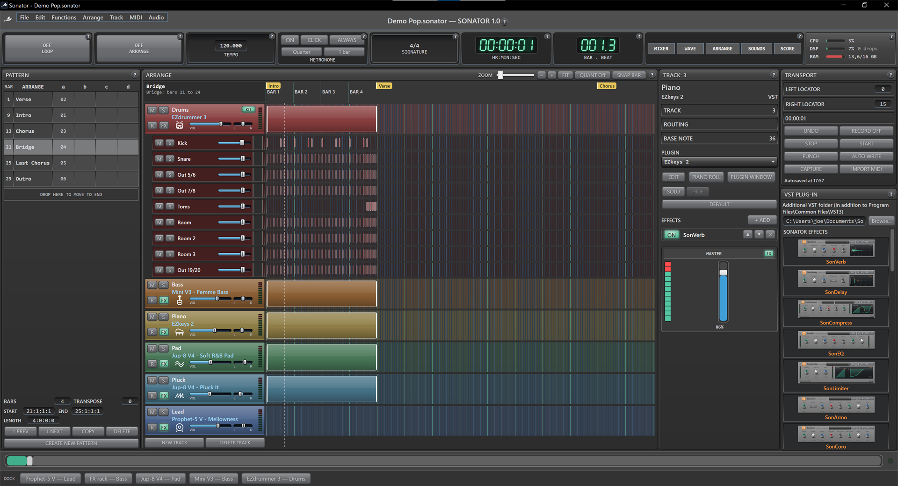

# Sonator

Sonator is a Windows DAW built around patterns, in the spirit of classic
sequencers such as Notator. A song is made of sections (intro, verse,
chorus...) that you build as patterns and line up in the arrangement. It hosts
VST3 instruments and effects, records MIDI and audio, mixes, and exports a
finished, tagged MP3 or WAV.

It is written in C# with .NET 8 and WPF. A native C++ bridge hosts VST3
plug-ins and runs Sonator's own effects.



More views are in the [screenshot gallery](docs/GALLERY.md).

## Features

### Patterns and arrangement

- **Patterns as song sections.** The patterns are the song's sections, played
  in the order of the arrangement.
- **Shared channels.** A track is one channel in every pattern: the same
  plug-in, effects, mixer strip and kit. Each pattern keeps its own notes and
  clips.
- **Follow the song.** The timeline shows one pattern at a time and follows the
  arrangement while the song plays.
- **Clone copies.** COPY places a clone of a pattern, so editing the kick in the
  intro changes every copy of the intro. *Copy as an independent pattern* makes
  a separate one.
- **Lengths and reordering.** Drag patterns to reorder them; each pattern has
  its own length. Arrange mode is saved with the project.

### VST3 hosting

- **Instruments and effects.** Sonator hosts VST3 instruments and effects with
  their own editor windows. Plug-ins are checked in separate helper processes,
  so a plug-in that crashes does not take Sonator down.
- **Plug-in browser.** The browser shows thumbnails of each plug-in's real
  editor.
- **Host sync.** Plug-ins receive tempo, position and play state, so built-in
  arpeggiators and groove players stay in time with Sonator.
- **Plug-in delay compensation.**
- **Recorded edits.** Parameter edits made in a plug-in's own window are picked
  up for automation and MIDI Learn.
- **Multi-output drum kits** (for example EZdrummer in Multichannel mode):
  - each kit piece gets its own mixer strip under **KIT**;
  - each piece gets its own lane on the timeline, showing its hits.
- **Sidechain.** Sidechain input reaches VST3 effects that have one and the
  SonCompress compressor.

### Sounds

- **New song by style.** A new project starts by asking what kind of music
  you want to make: Pop, Ballad, Rock, Funk & Disco, Soul & R&B,
  Hip-Hop & Trap, Lo-fi, House, Techno, Trance, Synthwave & 80s, Cinematic,
  Jazz & Blues, Country, Latin, Reggae and more, each at its usual tempo and
  with hits to know it by.
  - For each part the style is played with (drums, bass, piano, pads,
    lead...), Sonator suggests the installed sounds and grooves that suit it.
    It ranks them by the genres and character their makers file them under,
    and by their names: a groove library's Motown or Nashville, an 808, a
    Rhodes.
  - You hear a suggestion with a click, choose one per part, and the song
    starts with a track for each.
- **Sounds browser.** Search instrument presets and Toontrack grooves by name,
  category, instrument and bank, or keep only those that suit a genre.
- **Your samples and Kontakt libraries.** Add the folders where they are kept:
  - Every sample (WAV, AIFF, FLAC, MP3, OGG) and every Kontakt instrument is
    filed by its name and folders, alongside the plug-ins' sounds.
  - A loop whose name gives its tempo follows the song's tempo.
  - Kontakt instruments are heard from the preview recordings their libraries
    include, without loading Kontakt, and each shows how much its library
    weighs.
  - To load one, Sonator opens Kontakt on the track and you drag the
    instrument into it.
- **Preview and load.** Preview a sound and load it on the track. Favorites and
  recent sounds are kept.

### Mixer and effects

- **Mixer.** Faders, pan, mute and solo, meters, buses with sends, and a master
  with VU meters, a spectrum view and a test oscillator.
- **Effects rack.** Each channel has an effects rack where effects can be
  reordered by dragging and saved as presets.
- **Sonator effects**, running natively:

  | Effect | What it does |
  | --- | --- |
  | SonVerb | Reverb |
  | SonDelay | Delay |
  | SonCompress | Compressor, with sidechain |
  | SonEQ | Equalizer |
  | SonLimiter | Peak limiter |
  | SonArmo | Vocal harmonizer |
  | SonCoro | Chorus |
  | SonMast | Mastering chain, with streaming presets |

### Recording and editing

- **MIDI.**
  - Record from MIDI keyboards.
  - Record-arm per track.
  - Punch in and out, with every pass kept as a take you can audition.
  - **CAPTURE** recovers what you played while not recording.
- **Audio.** Recording from ASIO or WASAPI inputs.
- **Piano roll.** Velocity editing, quantize, swing and humanize. A step
  sequencer for quick drum programming.
- **Automation.**
  - Volume, pan and any plug-in parameter, drawn on lanes or recorded with
    **AUTO WRITE**.
  - **MIDI Learn** maps hardware knobs and faders to parameters.
- **Audio clips.**
  - The clip's waveform is drawn on the timeline.
  - Fade-in and fade-out handles.
  - Time-stretch that follows the song's tempo.
- **Stem separation.** *Import audio and separate into stems* splits a song
  (MP3, WAV...) into vocals, drums, bass and the rest, each on a track of its
  own.
  - It runs on this computer with HT-Demucs v4, whose model is downloaded once
    (about 166 MB). A one-minute song takes about a minute on the CPU.
  - The vocals can then go to Cromator or Sondyne.
- **Freeze and bounce.** Freeze or bounce a track to audio to save CPU.
- **Undo and redo** everywhere, plus autosave.

### Voice tools

- **Sondyne** corrects a sung take's pitch note by note. You can move notes,
  center them on their semitone and steady their drift.
- **Cromator** turns a sung take into a melody on a MIDI track, with the words
  it hears under the notes. It prints the track as a score or saves it as PDF.

### Export

- **Song export.** Export the song to WAV or MP3, with a loudness report.
- **Stem export.** Export each channel to its own WAV.
- **Song info and tags.** Title, artist, album, genre, year, composer, comment
  and cover picture are written into every exported file. The same window
  edits the tags of any existing MP3 or WAV.
- **MIDI.** Import and export standard MIDI files.
- **Command-line export:**

  ```powershell
  Sonator.exe "My Song.sonator.json" --export "My Song.mp3"
  ```

### Workspace

- **Panels.** Dockable plug-in windows and a mixer that opens in its own
  window.
- **System monitor.** A CPU, DSP-load and RAM monitor.
- **Help.** A `?` help badge on every panel.
- **Clock.** Transport with locators, loop, metronome, tempo and time
  signature, and a seven-segment time and bar display.

## Requirements

- Windows 10 or Windows 11
- [.NET 8 SDK](https://dotnet.microsoft.com/download/dotnet/8.0)
- An ASIO driver or any WASAPI audio device
- VST3 instruments and effects (optional; Sonator's own effects need none)
- A MIDI keyboard (optional, for recording)

## Build and run

```powershell
git clone https://github.com/joescaramucci/Sonator.git
cd Sonator
dotnet restore
dotnet run --project Sonator.csproj
```

A prebuilt `VstHostBridge.dll` is copied beside the application during the
build. Rebuild the native bridge only when changing its C++ source. See the
[native bridge README](native/VstHostBridge/README.md) and
[VST3 hosting architecture](docs/VST3_HOSTING.md).

Tests:

```powershell
dotnet test tests/Sonator.Tests
```

## Technology

- C# / .NET 8, WPF
- C++17 native bridge for VST3 hosting and Sonator effects, built only on
  Steinberg's MIT-licensed `pluginterfaces`
- NAudio (ASIO, WASAPI, MP3)
- DryWetMIDI
- TagLibSharp (song tags)
- Whisper.net (lyrics for Cromator)
- Microsoft.Data.Sqlite (sound library)

## License

Sonator is free software, licensed under the GNU General Public License v3.0.
See [LICENSE.txt](LICENSE.txt). Third-party components are listed in
[THIRD-PARTY-NOTICES.md](THIRD-PARTY-NOTICES.md). The screenshots show
third-party plug-ins (Toontrack, Arturia), which are trademarks of their
owners and are not part of Sonator.
