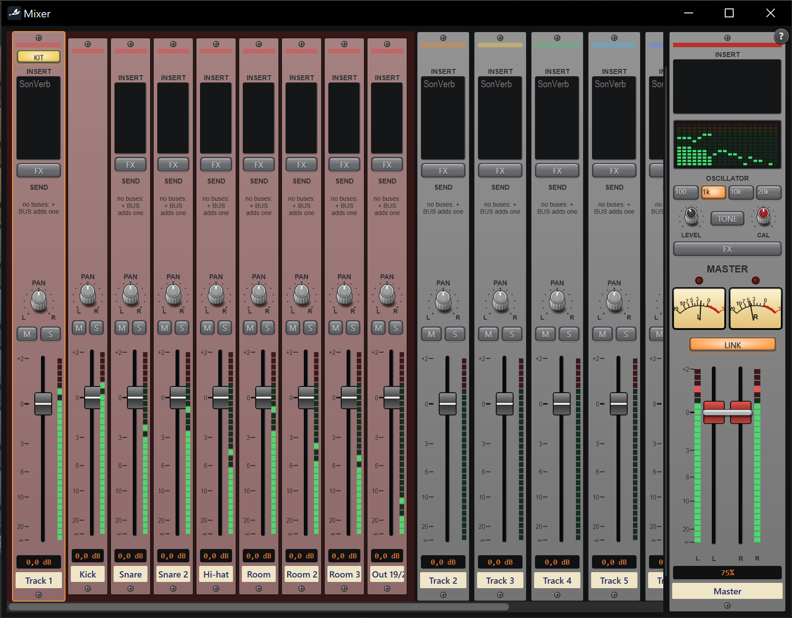
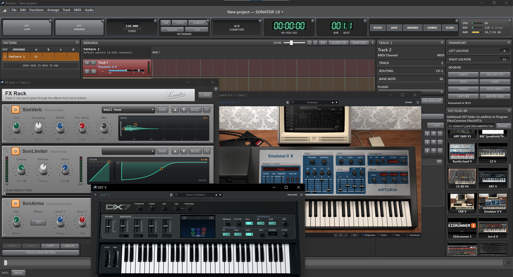
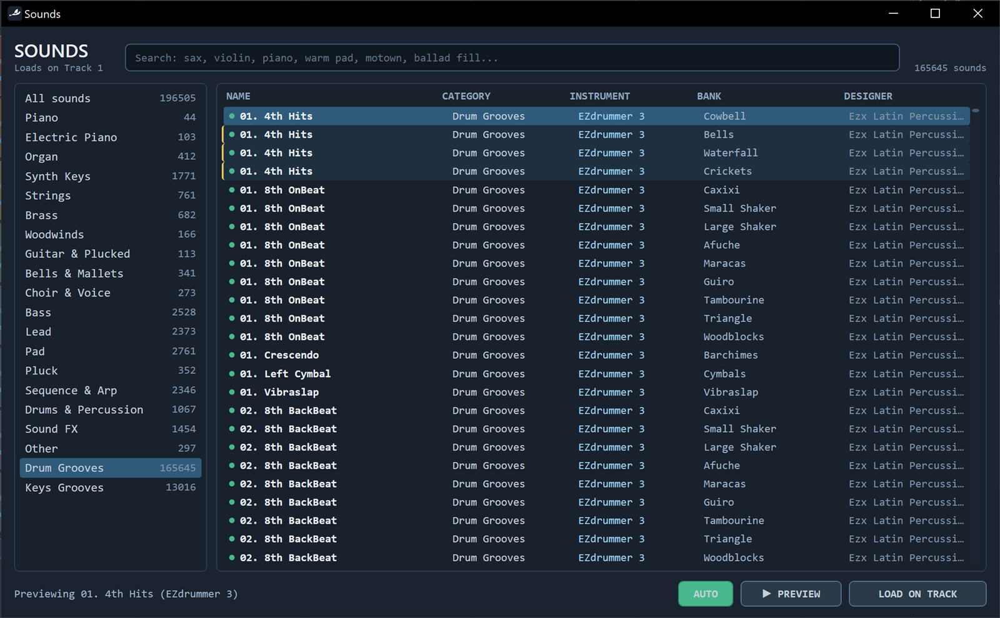
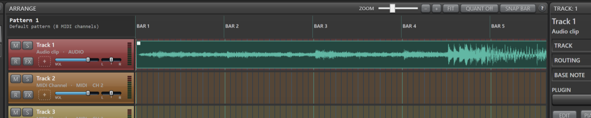
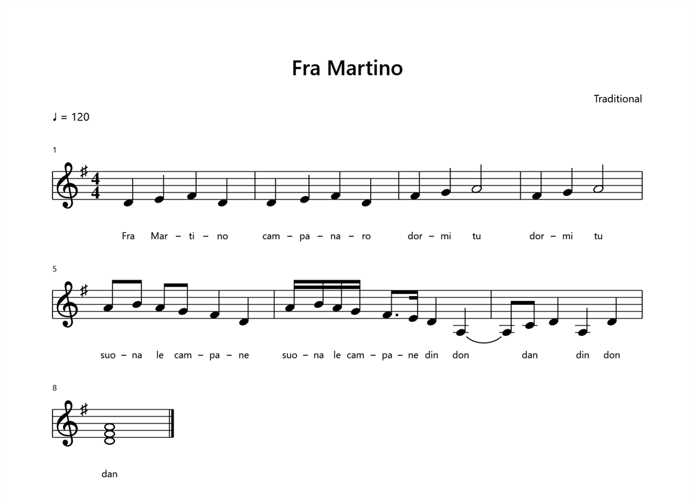

# Sonator Screenshot Gallery

## A song in the arrangement

A one-minute pop song in six sections: Intro, Verse, Chorus, Bridge, Last
Chorus, Outro. The pattern list on the left is the arrangement, and the
section chosen is highlighted. The timeline shows that section and follows the
song as it plays.

The drum channel runs EZdrummer 3 in Multichannel mode. Each kit piece has its
own lane (Kick, Snare, Toms, Room...) showing its hits. On the right are the
track inspector, the transport and the Sonator effects.

## Mixer with a multi-output drum kit

**KIT** opens a strip for every output of the drum plug-in, grouped under the
drum channel. Each strip has inserts, sends, pan, mute and solo, and a fader.
The master has VU meters, a spectrum view and a test oscillator.

## Effects rack and VST3 instruments

A channel's effects rack (SonVerb, SonLimiter, SonArmo) with two VST3
instruments' own editors open: Arturia Emulator II V and DX7 V. The plug-in
browser on the right shows thumbnails of each plug-in's real editor.

## Sounds

The Sounds browser searches every instrument preset and groove installed, by
category, instrument and bank. A sound can be previewed and loaded on the
track.

## Audio clips

An audio clip on the timeline with its waveform drawn. It has fade handles and
can follow the song's tempo.

## Score

Cromator prints a track as a score, with the lyrics heard in a sung take
placed under the notes. It saves to PDF.

The screenshots show third-party plug-ins (Toontrack EZdrummer, Arturia V
Collection). They are trademarks of their owners and are not part of Sonator.
